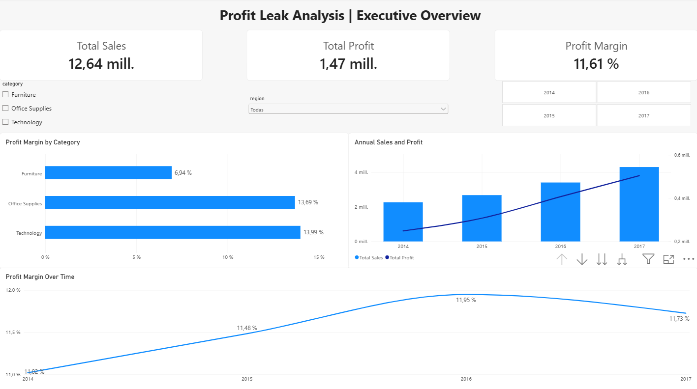
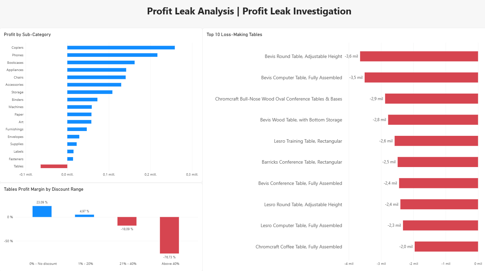
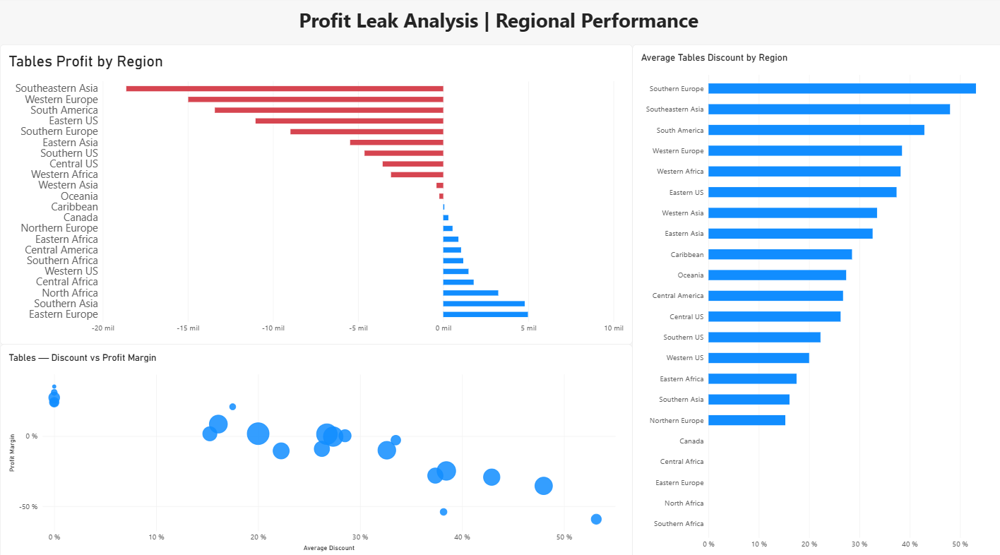

# Profit Leak Analysis

### End-to-End Data Analytics Project | Excel · MySQL · Power BI

## Project Overview

An end-to-end business analytics project using the Global Superstore dataset (2014–2017) to investigate profitability issues, identify loss-making products and regions, and evaluate the relationship between discounts and profit margins.

The project follows a complete analytics workflow: **Excel exploration → SQL data preparation and analysis → Power BI visualization → Business recommendations.**

## Business Problem

Despite consistent revenue growth, the company's profit margin declined from **11.95% in 2016 to 11.73% in 2017**.

The objective is to identify the products, regions and commercial practices associated with weaker profitability and recommend data-driven improvements.

## Tools & Skills

| Tool | Applications |
|---|---|
| **Excel** | Data exploration, pivot tables, profitability analysis |
| **MySQL** | Data cleaning, JOINs, aggregations, CTEs, window functions |
| **Power BI** | Data modeling, DAX measures, interactive dashboards, visualization |
| **Git & GitHub** | Version control, project documentation |

## Key Findings

| Metric | Result |
|---|---:|
| Total Sales | 12.64M |
| Total Profit | 1.47M |
| Overall Profit Margin | 11.61% |
| Furniture Profit Margin | 6.94% |
| Tables Profit Margin | -8.46% |
| Tables Total Loss | -64.08K |

**Main findings:**

- **Tables profitability:** Tables generated approximately 757K in sales but recorded a net loss of 64K.
- **Discount impact:** Tables sold with discounts above 40% had a -76.73% profit margin, compared with +23.09% for Tables without discounts.
- **Regional concentration:** Southeastern Asia, Western Europe and South America recorded the largest absolute losses from Tables.
- **Returns:** Furniture had the highest proportion of orders associated with returns (10.17%).
- **Profitability trend:** Revenue continued to grow in 2017 while overall profit margin declined slightly.

## Power BI Dashboard

The interactive dashboard contains three pages.

### 1. Executive Overview

Sales, profit, profit margin, category performance, annual trends and interactive filters.



### 2. Profit Leak Investigation

Loss-making sub-categories, discount analysis and the ten Table products generating the largest accumulated losses.



### 3. Regional Performance

Regional profitability, average discounts and the relationship between discount levels and profit margins.



**[Download the Power BI dashboard](powerbi/profit_leak_dashboard.pbix)**

Open the `.pbix` file in Power BI Desktop to explore the interactive visualizations. Refreshing the data requires access to the configured MySQL database.

## Business Recommendations

1. Review discount policies for Tables, prioritizing transactions with discounts above 20%.
2. Investigate pricing, shipping costs and product mix in regions with significant losses.
3. Review the ten Table products with the largest accumulated losses.
4. Track profit margins alongside revenue growth rather than focusing exclusively on sales.
5. Test pricing and discount adjustments before implementing broad policy changes.

See the complete **[Business Insights & Recommendations](insights/business_recommendations.md)** report.

## Repository Structure

```text
profit-leak-analysis/
├── data/
├── excel/
├── sql/
│   ├── 01_create_database.sql
│   ├── 02_create_tables.sql
│   ├── 03_import_data.sql
│   ├── 04_data_cleaning.sql
│   ├── 05_profitability_analysis.sql
│   ├── 06_discounts_analysis.sql
│   ├── 07_returns_analysis.sql
│   └── 08_temporal_analysis.sql
├── powerbi/
│   └── profit_leak_dashboard.pbix
├── images/
│   ├── executive_overview.png
│   ├── profit_leak_investigation.png
│   └── regional_performance.png
├── insights/
│   ├── excel_insights.md
│   └── business_recommendations.md
└── README.md
```
